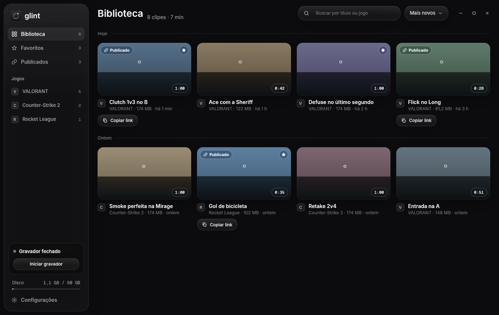

<p align="center">
  <picture>
    <source media="(prefers-color-scheme: dark)" srcset="docs/brand/wordmark-escuro.svg">
    
  </picture>
</p>

<p align="center"><b>Lightweight game clips for Windows.</b> F8 saves the last 60 seconds; one click shares it with a player right in Discord.</p>

<p align="center">
  <a href="README.pt-BR.md">Português</a> ·
  <a href="#install">Install</a> ·
  <a href="#sharing-links-optional-server">Links</a> ·
  <a href="#faq">FAQ</a> ·
  <a href="docs/ARCHITECTURE.md">Architecture</a> ·
  <a href="docs/brand/README.md">Brand</a>
</p>

<p align="center">
  
  
  
</p>

<p align="center"></p>

> The app follows the Windows language: English or Brazilian Portuguese. Strings live in translation files
> (`crates/app-ui/locales`, `crates/app-recorder/locales`, `server/src/i18n`), so other languages can be added.

## Why

The best-known clipping apps do the job, but they bring a feed, ads, a mandatory account and a cost you
can see in your FPS. Glint keeps only the good part: it records in the background without getting in
the way, keeps the play when you press F8 and turns the clip into a link that plays inside Discord.

## Features

- **Always-ready replay:** the last 60 s (15–120 s) stay in memory; F8 saves in ~150 ms.
- **Kill clips:** F9 right after a kill saves a short clip around it (8 s before, 2 s after by default);
  pressing again within 6 s joins the next kill into the same clip (marked x2, x3...).
- **Light:** capture and encoding on the GPU (AMD AMF, NVIDIA NVENC, Intel QSV), HEVC 1080p60; the
  recorder uses ~1% CPU and stops by itself when the game closes.
- **Finds the game by itself:** any full-screen game using the GPU; always/never record lists.
- **Game audio and microphone on separate tracks:** toggle each one in the player and when sharing.
- **Library and editor:** grid by day, favorites, accent-insensitive search, trim handles with instant
  preview, full screen.
- **Publish and copy link:** exports just the trimmed part as H.264, uploads in parts (resumes if it
  drops), and the link opens with a player embedded in Discord. Who can see it: only me, anyone with the
  link, or public. Select several clips to queue them; uploads pause while a game is open.
- **Export MP4:** saves the trimmed part to disk without publishing anything.
- **Optional watermark:** off by default; when on, it is drawn only on exports and published copies, never
  on the original clip.
- **Discord Rich Presence:** your profile shows "Clipping VALORANT with Glint" (or "Clipping with
  Glint" between games) and the time, like Medal. On by default; turn it off in Settings. Works without
  a server or sign-in.
- **Glass look** that follows Windows light/dark and turns solid when transparency effects are off or
  on battery saver.
- **Nothing inside the game:** no injection, no memory reading, no overlay. Safe with anti-cheat such as
  Vanguard.

## Install

1. Download the latest installer from [GitHub Releases](https://github.com/bps2414/glint/releases/latest)
   and run it (per-user install, no admin needed).
2. The recorder starts in the tray and waits for a game. Click the tray icon, or open Glint, to see the
   library.
3. Optional: Settings → System → **Start with Windows**. Updates are offered inside the app.

**SmartScreen warning.** The installer is not code-signed yet, so Windows may show "Windows protected your
PC". Click **More info → Run anyway**. The source is here and releases are built by CI from tagged commits;
signing is planned.

## Sharing links (optional server)

Glint works 100% locally with no account and no server: record, trim, export MP4.

To get a link that plays in Discord, you run your own small server on Cloudflare's free plan (a Worker with
D1 and R2). There is no shared server; each person or group deploys their own and pastes its URL into
Settings → Server (the Publish button shows "Connect server" until then). Login is Discord only; the first
person to sign in on a new server becomes admin and everyone else needs an invite.

[](https://deploy.workers.cloudflare.com/?url=https://github.com/bps2414/glint/tree/main/server)

Step-by-step guide (Discord app, secrets, limits): [`docs/DEPLOY.md`](docs/DEPLOY.md).

## Usage

| Action | How |
|---|---|
| Save the play | **F8** (changeable in Settings) |
| Save a kill | **F9** (changeable in Settings); press again within the combo window to extend the clip |
| Open the library | click the tray icon or open Glint |
| Trim | drag the handles on the timeline; the trim is saved |
| Next clip / play / full screen | ← → / Space / F |
| Publish | right panel → **Publish and copy link** → paste in Discord |

## FAQ

**Will it get me banned in Valorant (Vanguard)?** Glint records the window through Windows Graphics
Capture, the same API the Xbox Game Bar uses. It never touches the game process. Tested with Vanguard on.
No anti-cheat vendor has endorsed it, so use your own judgement.

**How much FPS does it cost?** In the synthetic test the average loss was ~1% recording the window. The
encoder runs on a separate block of the GPU from the one that draws the game.

**Where are my clips?** In `Videos\Glint` (configurable). The disk limit deletes the oldest first;
favorites and published clips never.

**Is a published clip public?** By default it is "with the link": it only opens for people who have the
address. You can switch to "only me" or "public" at any time, or delete it from the server.

**Linux?** System code is isolated so it can happen later; today it is Windows only.

## Build from source

Requirements: Windows 10/11, Rust (MSVC toolchain, 1.85+), Visual Studio Build Tools with C++, LLVM
(libclang for bindgen), and an **LGPL shared** FFmpeg build. The script below downloads a suitable FFmpeg
to `.deps\`, builds, tests and packs the app into `dist\Glint`:

```powershell
powershell -ExecutionPolicy Bypass -File scripts\build-windows.ps1
```

For day-to-day work see [CONTRIBUTING.md](CONTRIBUTING.md); for how the pieces fit together,
[docs/ARCHITECTURE.md](docs/ARCHITECTURE.md).

## License

Licensed under either of [Apache License, Version 2.0](LICENSE-APACHE) or [MIT license](LICENSE-MIT) at
your option. Unless you explicitly state otherwise, any contribution intentionally submitted for inclusion
in Glint by you, as defined in the Apache-2.0 license, shall be dual licensed as above, without any
additional terms or conditions.

Release builds ship FFmpeg as shared libraries under the LGPL; the license text is included in the package.
Fonts (Inter, Geist Mono) are under the SIL OFL.
