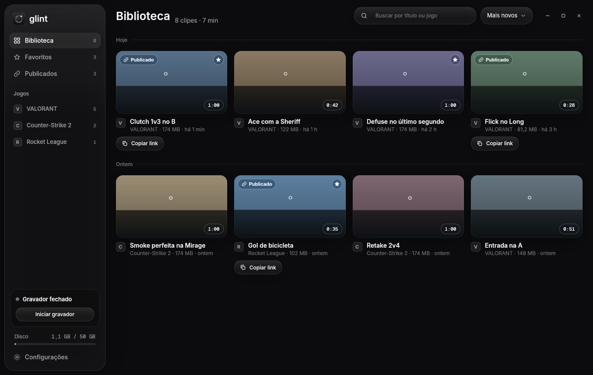

<p align="center">
  <picture>
    <source media="(prefers-color-scheme: dark)" srcset="docs/brand/wordmark-escuro.svg">
    
  </picture>
</p>

<p align="center"><b>Clipes de jogo leves no Windows.</b> F8 salva os últimos 60 segundos; um clique publica com player no Discord.</p>

<p align="center">
  <a href="README.md">English</a> ·
  <a href="#instalação">Instalação</a> ·
  <a href="#links-para-compartilhar-servidor-opcional">Links</a> ·
  <a href="#perguntas-frequentes">Perguntas</a> ·
  <a href="docs/ARCHITECTURE.md">Arquitetura</a> ·
  <a href="docs/brand/README.md">Marca</a>
</p>

<p align="center">
  
  
  
</p>

<p align="center"></p>

## Por que

Os apps de clipe mais conhecidos fazem o que prometem, mas vêm com feed, anúncios, conta obrigatória e
um peso que aparece no FPS. O Glint faz só a parte boa: grava em segundo plano sem atrapalhar o jogo,
guarda o lance quando você aperta F8 e transforma o clipe num link que toca direto no Discord.

## Recursos

- **Replay sempre pronto:** os últimos 60 s (15 a 120 s) ficam na memória; F8 salva em ~150 ms.
- **Clipes de kill:** F9 logo depois de uma kill salva um clipe curto em volta dela (8 s antes, 2 s depois por
  padrão); apertar de novo em até 6 s junta a próxima kill no mesmo clipe (marcado x2, x3...).
- **Leve:** captura e codificação na GPU (AMD AMF, NVIDIA NVENC, Intel QSV), HEVC 1080p60; o gravador
  usa ~1% de CPU e some sozinho quando o jogo fecha.
- **Detecta o jogo sozinho:** qualquer jogo em tela cheia usando a GPU; listas de sempre/nunca gravar.
- **Som do jogo e microfone em trilhas separadas:** ligue e desligue cada uma no player e no envio.
- **Biblioteca e editor:** grade por dia, favoritos, busca sem acento, recorte com alças e prévia na
  hora, tela cheia.
- **Publicar e copiar link:** exporta só o trecho em H.264, envia em partes (retoma se cair) e o link
  abre com player no Discord. Quem pode ver: só eu, com o link ou público. Selecione vários clipes para
  enfileirar; o envio pausa enquanto há um jogo aberto.
- **Exportar MP4:** salva o trecho recortado no disco, sem publicar nada.
- **Marca d'água opcional:** desligada por padrão; quando ligada, aparece só nas exportações e nas cópias
  publicadas, nunca no clipe original.
- **Rich Presence no Discord:** seu perfil mostra "Clipping VALORANT with Glint" (ou "Clipping with
  Glint" entre um jogo e outro) e o tempo, igual ao Medal. Ligado por padrão; desliga nas
  Configurações. Funciona sem servidor e sem login.
- **Visual de vidro** que segue o tema claro/escuro do Windows e fica sólido com "Efeitos de
  transparência" desligados ou em economia de bateria.
- **Sem nada dentro do jogo:** não injeta, não lê memória, não desenha overlay. Seguro com anti-cheat
  como o Vanguard.

## Instalação

1. Baixe o instalador mais recente em [GitHub Releases](https://github.com/bps2414/glint/releases/latest)
   e execute (instala só para o seu usuário, sem pedir administrador).
2. O Glint abre uma configuração rápida: suas teclas (aperte para conferir que o gravador ouviu), a
   qualidade (ele testa o que a sua placa de vídeo grava e recomenda um nível), entrar num servidor e as
   opções do Windows. Cada passo grava na hora, e **Pular configuração** fica com os valores
   recomendados. Quem atualiza de uma versão anterior passa por ela uma vez; conta e configurações
   ficam como estavam.
3. Depois o gravador fica na bandeja esperando um jogo. Clique no ícone da bandeja, ou abra o Glint,
   para ver a biblioteca.

**Atualizações.** Quando o Glint abre com o gravador fechado, um launcher pequeno procura versão nova
antes (5 s no máximo, e pula se estiver sem internet), instala, sobe o gravador e abre a biblioteca. O
gravador, que inicia com o Windows, também baixa versões novas em segundo plano e só instala quando nada
está acontecendo: sem jogo, sem gravação e com a janela do Glint fechada. Os dois desligam em
Configurações → Sistema → **Procurar atualizações sozinho** (o botão das Configurações continua procurando na
hora).

**Aviso do SmartScreen.** O instalador ainda não tem assinatura de código, então o Windows pode mostrar
"O Windows protegeu o computador". Clique em **Mais informações → Executar assim mesmo**. O código está
aqui e os releases são gerados pelo CI a partir de tags; a assinatura está nos planos.

## Links para compartilhar (servidor opcional)

O Glint funciona 100% local, sem conta e sem servidor: gravar, recortar, exportar MP4.

Para ter um link que toca no Discord, você sobe o seu próprio servidor pequeno no plano grátis da
Cloudflare (um Worker com D1 e R2). Não existe servidor compartilhado: cada pessoa ou grupo tem o seu.
Para entrar no servidor de um amigo, cole o link do convite que ele mandou (na configuração inicial ou
em Configurações → Servidor): o convite vira a sua conta, sem login. Para ter o seu, **Criar meu
servidor** no app sobe tudo na sua conta grátis da Cloudflare e já te conecta como admin.

[](https://deploy.workers.cloudflare.com/?url=https://github.com/bps2414/glint/tree/main/server)

Passo a passo (app no Discord, segredos, limites): [`docs/DEPLOY.md`](docs/DEPLOY.md).

## Como usar

| Ação | Como |
|---|---|
| Salvar o lance | **F8** (o atalho muda em Configurações) |
| Salvar uma kill | **F9** (o atalho muda em Configurações); aperte de novo na janela do combo para estender o clipe |
| Abrir a biblioteca | clique no ícone da bandeja ou abra o Glint |
| Recortar | arraste as alças na linha do tempo; o recorte fica salvo |
| Trocar de clipe / tocar / tela cheia | ← → / Espaço / F |
| Publicar | painel à direita → **Publicar e copiar link** → cole no Discord |

## Perguntas frequentes

**Dá ban no Valorant (Vanguard)?** O Glint grava a janela pelo Windows Graphics Capture, a mesma API
que a Barra de Jogos usa. Não toca no processo do jogo. Foi testado com o Vanguard ativo. Nenhuma
fabricante de anti-cheat endossa o app, então use seu próprio critério.

**Quanto pesa no FPS?** No teste sintético a perda média ficou em ~1% gravando a janela. O encode é
feito pela GPU, num bloco separado do que desenha o jogo.

**Onde ficam os clipes?** Em `Vídeos\Glint` (dá para mudar). O limite de disco apaga os mais antigos
primeiro; favoritos e publicados nunca.

**Meu clipe publicado é público?** Por padrão fica "com o link": só abre para quem tem o endereço. Dá
para trocar para "só eu" ou "público" a qualquer momento, ou apagar do servidor.

**Como reporto um bug ou mando feedback?** Configurações > Ajuda > **Reportar bug** / **Enviar
feedback**, ou **Reportar bug** na bandeja. Não precisa de conta no GitHub. A mensagem e as informações
do PC (versão do app, Windows, GPU) viram uma issue pública no GitHub; o contato que você deixar e os
logs do gravador (opcionais, sem a pasta do seu usuário e sem tokens) ficam privados com o mantenedor.
**Ver o que será enviado** mostra o texto exato antes de enviar. Falha de segurança vai pelo
[`SECURITY.md`](SECURITY.md), não por esse botão.

**E no Linux?** O código de sistema está isolado para isso ser possível no futuro; hoje é só Windows.

## Compilar do código

Requisitos: Windows 10/11, Rust (toolchain MSVC, 1.85+), Visual Studio Build Tools com C++, LLVM
(libclang para o bindgen) e um FFmpeg **LGPL shared**. O script abaixo baixa um FFmpeg adequado para
`.deps\`, compila, testa e monta o pacote em `dist\Glint`:

```powershell
powershell -ExecutionPolicy Bypass -File scripts\build-windows.ps1
```

Para o dia a dia, veja o [CONTRIBUTING.md](CONTRIBUTING.md); para como as peças se encaixam,
[docs/ARCHITECTURE.md](docs/ARCHITECTURE.md) (em inglês).

## Licença

Licenciado, à sua escolha, sob a [Apache License 2.0](LICENSE-APACHE) ou a [licença MIT](LICENSE-MIT).
Salvo declaração em contrário, toda contribuição enviada intencionalmente para o Glint, como definido na
Apache-2.0, entra com essa licença dupla, sem termos adicionais.

Os builds de release trazem o FFmpeg como bibliotecas compartilhadas sob a LGPL; o texto da licença vai no
pacote. As fontes (Inter, Geist Mono) são OFL.
